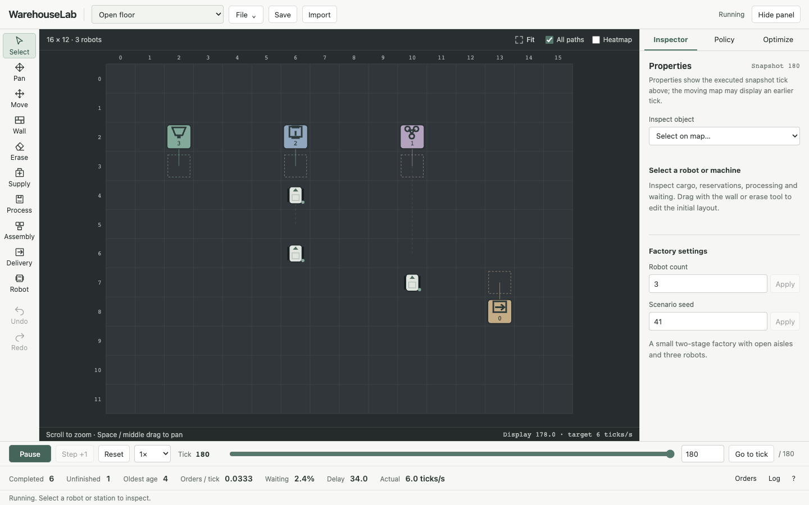

# WarehouseLab

[**Open WarehouseLab**](https://yeopbong.github.io/warehouselab/) and press **Start** to run the example factory. No account or installation is needed.

WarehouseLab is a multi-robot factory simulator. Edit a layout, move materials through a two-stage production chain, and inspect robot tasks, queues, inventory and completed orders. Replay a run or compare dispatch and routing policies with preset, random and genetic-algorithm search.



## Try a factory

- **Start**, **Pause** and **Step +1** control the run. The timeline replays executed ticks.
- Select a robot or machine to inspect it. Use the map tools to edit the initial layout.
- **Policy** changes dispatch and routing. **Optimize** searches configurations and compares a candidate with the baseline on your current factory.
- **File → Export JSON** saves a portable copy. **Save locally** and **Restore** keep one factory in this browser.

Complex layouts can become congested or deadlock. Search can select a supplied preset; GA is not guaranteed to improve on it. The original examples have finite order batches.

## Run locally

Install **Node.js 22.12 or newer** and npm:

```sh
git clone https://github.com/yeopbong/warehouselab.git
cd warehouselab
npm ci
npm run dev
```

Open the printed URL, normally `http://127.0.0.1:5173`. For a production build, run `npm run build`, then `npm run preview`.

The [usage guide](docs/usage.md) covers controls, search budgets and CLI commands. See [design](docs/design.md) for the shared simulation kernel and links to recorded experiments.

[MIT license](LICENSE) · [Third-party software](THIRD_PARTY.md)
