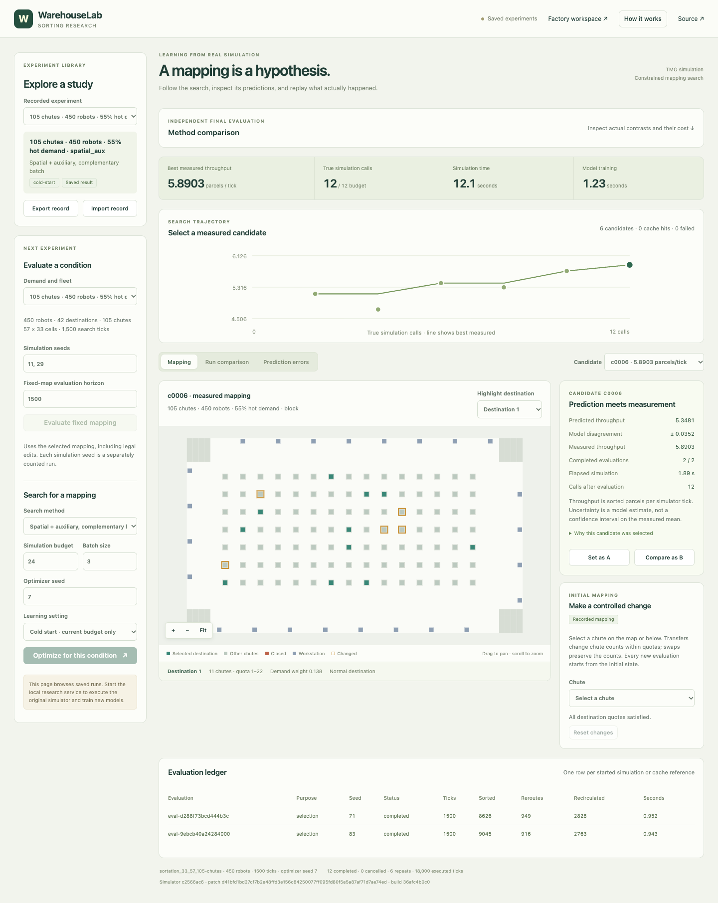

# WarehouseLab

[**Open the workbench**](https://yeopbong.github.io/warehouselab/) to explore recorded sorting experiments. New sorting evaluations require the local service below; the separate [factory example](https://yeopbong.github.io/warehouselab/#factory) runs entirely in your browser.

WarehouseLab studies destination-to-chute mappings for multi-robot sorting. Inspect search decisions, edit legal assignments, and compare model predictions with real TMO simulations and replay.



## Run locally

Use **Python 3.11+**, **Node.js 22.12+**, a C++17 compiler, CMake, Boost, spdlog and OpenMP. [Platform setup and controls](docs/usage.md) include dependency commands.

```sh
git clone https://github.com/yeopbong/warehouselab.git
cd warehouselab
python3 -m venv .venv
source .venv/bin/activate
pip install -e '.[test]'
python scripts/setup-tmo.py
npm ci
npm run build
python -m warehouse_sorting serve
```

Open `http://127.0.0.1:8000`. Select a candidate to inspect its forecast, changes and measured results, or compare two runs. Demand and fleet controls distinguish fixed-mapping tests from new optimization. Records, traces and models stay in `.sorting-data/`.

## Method

Search combines swaps, quota-constrained transfers, larger mutations and restarts. A destination-label-invariant spatial ensemble jointly predicts sorted parcels per tick, navigation waiting and chute closures. Batches consider performance, model disagreement and complementary changes. Unmeasured candidates use static features and earlier observations only.

Comparisons include greedy mappings, the upstream EA, a simple surrogate and mechanism ablations. With 24 online calls per optimization, historical data raised the full method's two main test means from **6.2739/6.1605** to **6.6886/6.5783 parcels per tick**, at an additional shared cost of 192 training-condition calls. Spatial features, auxiliary supervision and complementary batches did **not** show consistent individual benefits. See [methods and limitations](docs/design.md) and [measured results](results/tmo/summary.json).

The pinned [TMO runtime](https://github.com/lunjohnzhang/tmo_public) and PIBT planner include destination and parcel-routing corrections. Sorted throughput differs from the upstream task-completion rate. Congestion and recirculation remain possible. Runs start from the initial state; arbitrary mid-run restoration is unsupported. Static hosting cannot launch the native simulator. These finite-horizon, three-repeat comparisons do not establish broad generalization.

```sh
npm run typecheck && npm test && npm run build
python -m pytest -q
npm run test:e2e
```

[MIT license](LICENSE) · [Third-party software](THIRD_PARTY.md)
